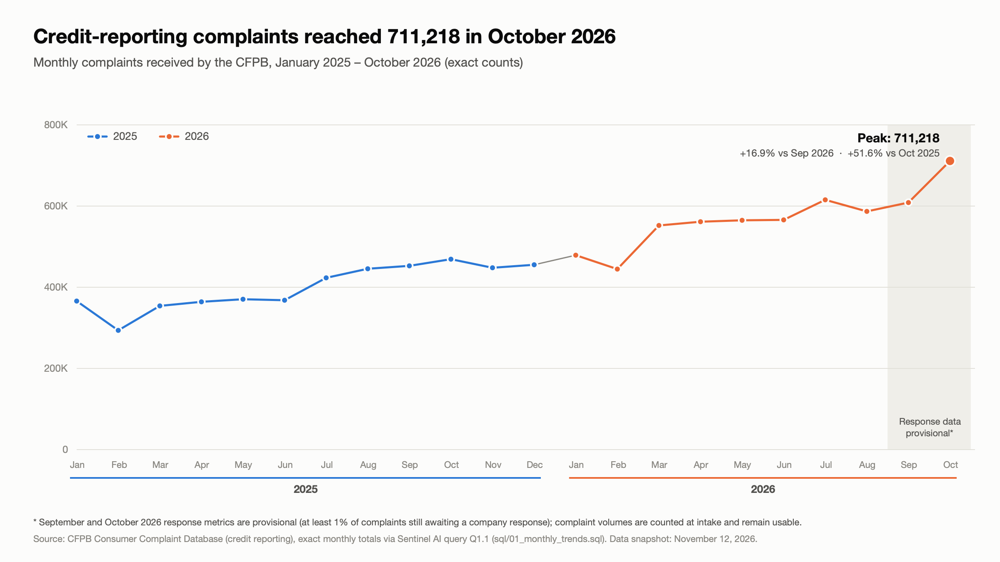
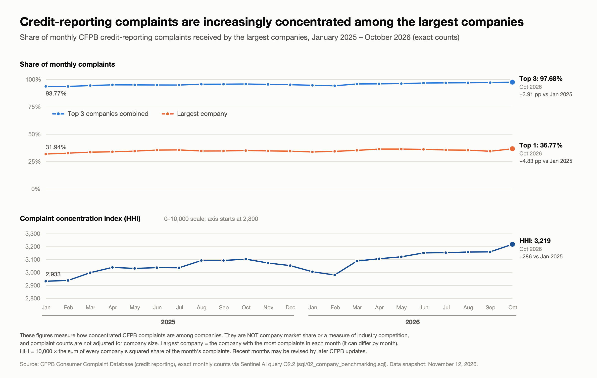
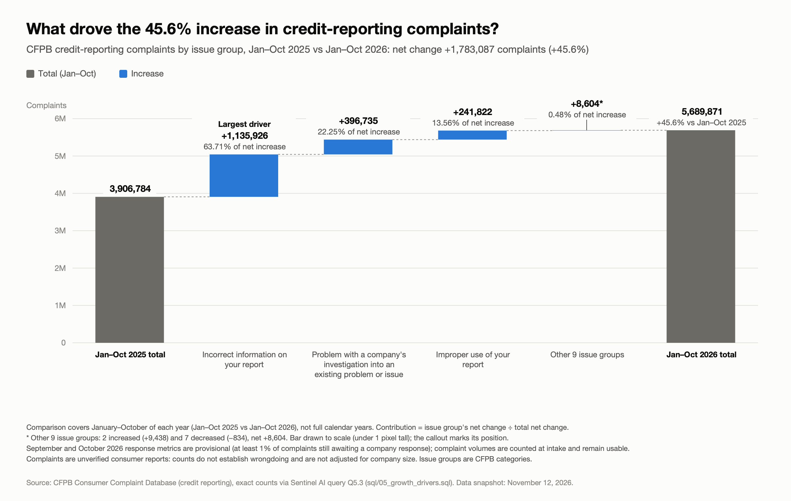
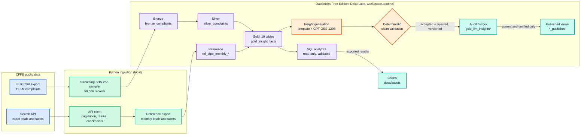

# Sentinel AI — Financial Complaint Lakehouse with Evidence-Grounded AI Insights

[](https://github.com/ManitJ/sentinel-ai/actions/workflows/tests.yml)


An end-to-end data engineering and analytics project on the public **CFPB Consumer Complaint
Database**. It covers reproducible ingestion and sampling, a Bronze → Silver → Gold Delta Lake
lakehouse on Databricks Free Edition, validated SQL analytics with three charts, and monthly insight
reports in which **every published claim is checked against the Gold metrics it cites**. Everything
runs at zero cost: public data, open-source Python and Databricks Free Edition serverless compute.

## The problem and the objective

The CFPB publishes millions of consumer complaints about financial companies. Credit-reporting
complaints alone totalled 10,500,160 between January 2025 and October 2026. Turning this into
trustworthy monthly insight is harder than it looks: the data keeps changing, response fields fill
in weeks after a complaint arrives, a sample can silently distort volumes, and an LLM can write
fluent summaries that are numerically right but misleading.

The objective was to build a pipeline that an analyst could rely on:

- **Exact where possible.** Volumes and breakdowns come from exact CFPB population counts.
  A weighted stratified sample is used only where no exact figure exists, and its results are always
  labelled as estimates with 95% confidence intervals.
- **Validated at every step.** Each lakehouse layer, each SQL query and each AI-generated claim is
  checked against independent benchmarks before it is used.
- **Traceable.** Every chart and finding cites the query that produced it; every published AI claim
  cites the Gold `fact_id`s it is based on.

## Key results

Three questions, each answered by a validated SQL query in [`sql/`](sql/) and charted from that
query's exported Databricks result. All values in this section are **exact complaint counts** unless
marked as an estimate. Full analysis: [`docs/sql_analytics.md`](docs/sql_analytics.md).

### 1. Monthly complaint trends



Monthly complaints more than doubled, from a low of 293,833 in February 2025 to a peak of 711,218 in
October 2026 [Q1.1]. Every month of 2026 was higher than the same month of 2025, by between 30.9%
and 56.0% [Q1.1]; October 2026 was 16.9% above September and 51.6% above October 2025 [Q6.1].
The shaded months have provisional *response* data; their complaint volumes are counted at intake
and remain usable.

### 2. Company complaint concentration



Complaints are becoming more concentrated. The three largest companies' combined share of monthly
complaints rose from 93.77% in January 2025 to 97.68% in October 2026, and the
complaint concentration index (HHI) rose from 2,933 to 3,219 [Q2.2]. Experian moved from third to
first place between October 2025 and October 2026 [Q2.3]; over all 22 months, TransUnion, Equifax
and Experian received 95.86% of complaints [Q2.1]. This measures how concentrated
*complaints* are — it is not market share, and counts are not adjusted for company size.

### 3. Growth drivers



January–October complaints rose by 1,783,087 (+45.6%) between 2025 and 2026 [Q5.1]. One issue group,
"Incorrect information on your report", accounts for 1,135,926 of that increase (63.71%); problems
with a company's investigation add 396,735 (22.25%) and improper use of a report 241,822 (13.56%).
The other nine issue groups together add 8,604 (0.48%), and the four bars reconcile exactly to the
total [Q5.3]. Within inaccurate-information complaints, the most common specific problem is
information that consumers say belongs to someone else — an **estimated** 38.8% of all complaints
(95% CI 38.37%–39.24%), from the weighted sample [Q3.4].

Complaints are unverified consumer submissions: they do not establish wrongdoing by any company.

## Highlights

| Metric | Value |
|---|---|
| Credit-reporting complaints covered (Jan 2025 – Oct 2026, exact API totals) | **10,500,160** |
| Stratified sample records (2,273 per month × 22 months) | **50,006** |
| Gold Delta tables | **10** |
| SQL showcase queries validated in Databricks against independent benchmarks | **17 of 17 passed** (63 checks) |
| Published template reports (one per month) | **22** |
| Published LLM report (GPT-OSS-120B via `ai_query`, prompt/validator v2) | **1** (October 2026) |
| Sample-estimate 95% CI coverage vs exact API shares | 924 of 974 comparisons (94.9%) |
| Offline tests | **501** passing locally |

## Architecture



| Layer | Notebook / folder | What it does |
|---|---|---|
| Bronze | `01_bronze_ingest` | Loads the sample as received (24 source columns + lineage); `MERGE` on `complaint_id` |
| Silver | `02_silver_transform` | Typed dates, booleans, USPS state codes, tag flags; original values kept |
| Reference | `03_gold_reference_load` | Exact monthly API totals and facet counts |
| Gold | `04_gold_build` | Exact volumes and breakdowns, weighted estimates with CIs, estimator calibration, LLM-ready fact table |
| Insights | `05_llm_insights` (+ `lib_insights`) | Template and LLM claims, validation, versioned history, published views |
| SQL analytics | `sql/`, `06_sql_showcase_validation` | Read-only analysis queries and a notebook that checks their results against benchmarks |

## Data engineering

- **Ingestion.** A CFPB API client with cursor pagination (`search_after`), retries, checkpoints and
  windowed backfills, plus a streaming reader for the 19.1-million-row bulk export.
- **Sampling.** A reproducible stratified sample: 2,273 complaints per month selected by SHA-256 hash,
  each weighted to its month's exact total. Sample estimates were checked against exact API shares:
  924 of 974 95% confidence intervals contained the true value (94.9%).
- **Lakehouse.** Bronze, Silver and Gold Delta tables in Unity Catalog. Every notebook validates its
  inputs and outputs (row counts, unique IDs, strata, weights, reconciliation with the API) and writes
  idempotently with `MERGE`: a second run changes 0 rows.
- **Exact vs estimated.** Gold keeps the two apart. Volumes and one-way breakdowns use exact API
  counts only; sample-based tables carry standard errors, 95% CIs and a reliability flag.

Details: [`docs/data_sampling.md`](docs/data_sampling.md) · [`docs/gold_methodology.md`](docs/gold_methodology.md)

## SQL analytics

Six SQL files in [`sql/`](sql/) answer business questions about monthly trends, company
concentration, issue mix, geography, growth drivers and company responses. All queries are read-only
(`SELECT` / `WITH` only), derive their periods from the data, and document their metric definitions
and caveats in a header comment.

Queries Q2.1–Q6.2 were executed in Databricks by a validation notebook that refuses to run anything
other than a single `SELECT`/`WITH` statement and checks each result against benchmarks computed
independently from the reference data: **17 of 17 queries passed, 63 of 63 checks**
([`sql/results/validation_summary.md`](sql/results/validation_summary.md)). The charts above are
built by small Python modules from full result exports in
[`sql/results/exports/`](sql/results/exports/); they validate each export before drawing it, and tests
check every plotted value against the export.

## Evidence-grounded LLM insights

Monthly reports are generated twice from the same evidence: by a deterministic template and by
GPT-OSS-120B through Databricks `ai_query`. The model sees only one month of aggregate, allow-listed
facts from `gold_insight_facts` — never complaint records or narratives — and must cite a `fact_id`
for every claim. Deterministic Python then checks every number, citation, comparison, ranking and
label before anything is published.

October 2026 is **provisional**: when the data was retrieved, 53.2% of that month's complaints were
still awaiting a company response. Response, public-response, timeliness and submission-channel
metrics are therefore withheld from the evidence, and the report carries a disclaimer. Bracketed
values are the cited `fact_id`s.

**Published v2 LLM-generated report** (GPT-OSS-120B via `ai_query`, prompt/validator v2; 6 accepted
claims; reproduced verbatim from `workspace.sentinel.gold_llm_insights_published`):

> **October 2026**
>
> > Provisional data: many of this month's complaints were still awaiting a company response when the data was retrieved, so response, public-response, timeliness and submission-channel figures are omitted and other figures may be revised.
>
> - Total credit reporting complaints in October 2026 were 711,218. [47bd3f0e5a3badb0]
> - This represents a month-over-month increase of +16.9% for credit-reporting complaints. [3942548c7ca343eb]
> - Year-over-year, credit-reporting complaints rose +51.6% compared with the same month last year. [3b6213f198930dfd]
> - Experian Information Solutions Inc. received the most company complaints (261,507) and accounted for 36.8% of the month's company complaints. [98f66efb0391d592, 32d004c75e5768a4]
> - TransUnion Intermediate Holdings, Inc. was second with 233,620 complaints, representing 32.8% of the month's company complaints. [e071d46c0fef82a4, 36b4e024ac843ef8]
> - The most common issue was "Incorrect information on your report" with 434,490 complaints, comprising 61.1% of issue complaints. [03fe881639d324e6, 2ed50c6e16eae52f]
>
> _Source: CFPB complaint data at the reference snapshot; figures may be revised by later updates._

### Safeguards

| Area | How it is handled |
|---|---|
| **Evidence validation** | Each claim must cite fact IDs from that month's evidence; every number must match a cited fact at its displayed precision; comparisons, rankings, direction words, estimate labels and confidence intervals are checked; causal, predictive, legal or advisory wording, absolute claims ("100%", "all", "none") without exact support, and paraphrased CFPB category labels are rejected. |
| **Provisional data** | A month is provisional while ≥ 1% of its complaints are "In progress" (currently September and October 2026). This is a reporting safeguard, not proof that other months are complete. |
| **Privacy** | Consumer narratives are never ingested. The model sees only aggregate facts — no complaint records, IDs or ZIP codes; counts below 10 are removed. Rejected claim text and raw model responses are not stored (hash and length only). Raw data stays out of Git. |
| **Historical publication** | Insight tables are an append-only audit history keyed by month, generator, prompt/validator version and evidence hash. Outdated rows are marked *superseded*, never deleted or rewritten. Consumers read the `*_published` views, which expose only current, verified insights and their accepted claims. |
| **Idempotency and cost** | Insight writes are insert-only; months whose evidence is unchanged are served from the cache with 0 model calls; a dry run (the default) makes no calls and no writes. |

Details: [`docs/llm_insights.md`](docs/llm_insights.md)

## Reproducibility and testing

The **501 offline tests** use synthetic data and fakes; `tests/conftest.py` blocks network access, so
no Databricks workspace, credentials, API access or model calls are needed. They cover the ingestion
and sampling code, Python reference implementations of the Silver and Gold rules, static checks of
the notebook code, the SQL files and validation notebook, the evidence validator, and the charts:
each chart test recomputes the plotted values from the exported query result and checks that the
committed SVG and PNG are regenerated from it. Tests that need the local CFPB data files (kept out of
Git) are skipped automatically when the files are absent, as in CI.

GitHub Actions ([`.github/workflows/tests.yml`](.github/workflows/tests.yml)) runs the suite on
Python 3.11 for every push to `main` and every pull request targeting `main`, with read-only permissions and no secrets.

## Limitations

- **Snapshot data.** Figures reflect reference data retrieved on November 12, 2026; later CFPB
  updates can revise them, especially for recent months.
- **Year to date.** 2026 covers January–October, so year-over-year comparisons use matched months.
- **Provisional responses.** Response metrics for September and October 2026 are excluded or flagged.
- **Complaints are not findings.** Complaints are unverified consumer submissions; counts are not
  adjusted for company size, customer base or state population, and related corporate entities are
  not merged.
- **Estimates have uncertainty.** Sample-based figures are reported only with 95% confidence intervals
  and only where flagged reliable.
- **One LLM report.** Databricks Free Edition is quota-limited, so one LLM report (October 2026) has
  been published; the other months use the deterministic template.
- **No hosted service.** Outputs live in Delta tables and views in a Databricks Free Edition workspace
  and in the static charts in this repository.

## Dataset

- **Source:** [CFPB Consumer Complaint Database](https://www.consumerfinance.gov/data-research/consumer-complaints/)
  via its public search API and its bulk CSV export.
- **Scope:** product *"Credit reporting or other personal consumer reports"*, complaints received
  **January 2025 – October 2026** (22 complete months).
- **Population:** 10,500,160 complaints (exact monthly totals from the API; the bulk file
  reproduces every monthly total exactly).
- **Sample:** 50,006 complaints — 2,273 per month, selected by SHA-256 hash (simple random sample
  within each month, reproducible from a fixed salt). Each record carries a weight `N_month / 2,273`
  for population estimates.

## Tech stack

**Data & AI:** Python 3.11 · pandas · PyArrow · requests · PySpark · Delta Lake · Unity Catalog · SQL ·
Databricks AI Functions (`ai_query`, GPT-OSS-120B) &nbsp;|&nbsp;
**Platform:** Databricks Free Edition (serverless) &nbsp;|&nbsp;
**Charts:** dependency-free SVG generated in Python, PNG rendered with macOS `sips` &nbsp;|&nbsp;
**Quality:** pytest · GitHub Actions

## Exploring the repository

| If you want to see… | Start here |
|---|---|
| The findings | [`docs/sql_analytics.md`](docs/sql_analytics.md) |
| The SQL | [`sql/`](sql/) and its [README](sql/README.md) |
| The lakehouse | [`databricks/notebooks/`](databricks/notebooks/) (`01` → `04`) |
| The LLM pipeline and validator | [`05_llm_insights.py`](databricks/notebooks/05_llm_insights.py), [`lib_insights.py`](databricks/notebooks/lib_insights.py), [`docs/llm_insights.md`](docs/llm_insights.md) |
| How estimates work | [`docs/data_sampling.md`](docs/data_sampling.md), [`docs/gold_methodology.md`](docs/gold_methodology.md) |

```
sentinel-ai/
├── .github/workflows/      tests.yml (CI: offline test suite)
├── src/
│   ├── ingestion/          CFPB API client, windowed pipeline, checkpoints, bulk download,
│   │                       stratified sampler, API benchmarks, CLI (python -m ingestion)
│   └── lakehouse/          Silver and Gold reference rules, reference-data export, SQL validation
│                           tooling, chart generators
├── databricks/notebooks/   01_bronze_ingest · 02_silver_transform · 03_gold_reference_load ·
│                           04_gold_build · 05_llm_insights (+ lib_insights) ·
│                           06_sql_showcase_validation (generated)
├── sql/                    analysis queries 00–06; results/ (validation report, previews, exports)
├── docs/                   SQL analytics report; sampling; Gold methodology; LLM insights;
│                           assets/ (charts, SVG + PNG)
├── tests/                  offline tests (network access is blocked)
├── requirements.txt        pinned environment
├── requirements-test.txt   minimal test dependencies (versions from requirements.txt)
└── pytest.ini
```

## Getting started

### 1. Set up the environment and run the tests

Requirements: Python 3.11 (developed in a Conda environment on an 8 GB Apple M2).

```bash
conda create -n sentinel-ai python=3.11 -y
conda activate sentinel-ai
pip install -r requirements.txt
python -m pytest -ra
```

For the tests alone, `pip install -r requirements-test.txt` is enough (numpy, pandas, pyarrow,
pytest, requests).

### 2. Rebuild the dataset locally

```bash
export PYTHONPATH=src
python -m ingestion bulk-download        # ~366 MB zip -> data/external/ (resumable)
python -m ingestion bulk-sample          # 50,006-row sample -> data/bronze/cfpb_credit_reporting_sample/
python -m ingestion api-benchmarks       # exact monthly totals + facets (22 small API requests)
python -m ingestion compare-sample       # sample estimates vs exact population shares
python -m lakehouse.reference_export     # reference Parquet for Databricks -> data/reference/upload/
```

The API pipeline can also ingest complete date windows directly, e.g.
`python -m ingestion backfill --start-date 2026-11-01 --end-date 2026-11-02 --dry-run`.

Measured on the development machine: bulk download 14.3 s, full scan and sample 41.3 s over
19.1 million rows, peak memory 708 MB, combined sample Parquet 2.2 MB.

### 3. Run the lakehouse in Databricks Free Edition

1. Create the schema and volume:
   `CREATE SCHEMA IF NOT EXISTS workspace.sentinel;`
   `CREATE VOLUME IF NOT EXISTS workspace.sentinel.raw_files;`
2. Upload to `/Volumes/workspace/sentinel/raw_files/`:
   `cfpb_credit_reporting_sample.parquet` (from `data/bronze/cfpb_credit_reporting_sample/_upload/`)
   and the two files in `data/reference/upload/`.
3. Import the notebooks from `databricks/notebooks/` and run `01`–`04` in order on serverless
   compute. Each validates its inputs and outputs and can be rerun safely.

### 4. Generate insights

Import `lib_insights.py` and `05_llm_insights.py` into the same workspace folder.

| Goal | Widgets | Model calls |
|---|---|---|
| Preview prompts and publication plan (default) | `dry_run = true` | 0 (no writes) |
| Template reports for all months | `dry_run = false`, `max_calls = 0`, `months = all` | 0 |
| One LLM report | `dry_run = false`, `max_calls = 1`, `months = latest` | ≤ 1 |

Read results from `gold_llm_insights_published` and `gold_llm_insight_claims_published`. Databricks
Free Edition is quota-limited, so keep `max_calls` small.

### 5. Run and validate the SQL, then rebuild the charts

Run the queries in the Databricks SQL Editor, or import
`databricks/notebooks/06_sql_showcase_validation.py` and **Run all** to validate them (see
[`sql/README.md`](sql/README.md)). The charts are regenerated from the exports in
`sql/results/exports/` (PNG rendering uses macOS `sips`):

```bash
export PYTHONPATH=src
python -m lakehouse.monthly_trends_chart
python -m lakehouse.company_concentration_chart
python -m lakehouse.growth_drivers_chart
```

## License and data

No license has been chosen yet. CFPB complaint data is published by the U.S. Consumer Financial
Protection Bureau; see the CFPB website for its terms of use.
