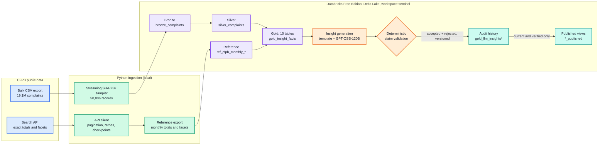

# Sentinel AI — Financial Complaint Lakehouse with Evidence-Grounded AI Insights

[](https://github.com/ManitJ/sentinel-ai/actions/workflows/tests.yml)


An end-to-end data engineering and applied AI project on the public **CFPB Consumer Complaint
Database**: reproducible ingestion and sampling, a Bronze → Silver → Gold Delta Lake lakehouse on
Databricks Free Edition, and monthly insight reports in which **every published claim is checked
against the Gold metrics it cites**. The project runs at zero cost: public data, open-source Python
and Databricks Free Edition serverless compute.

## Why this project

**The problem.** The CFPB publishes millions of consumer complaints about financial companies.
Credit-reporting complaints alone totalled 10.5 million between January 2025 and October 2026, and
their monthly volume more than doubled from February 2025 (293,833) to October 2026 (711,218). Turning this into trustworthy monthly insight is harder than it looks: the data keeps
changing, response fields fill in weeks after a complaint arrives, a sample can silently distort
volumes, and an LLM can produce fluent summaries that are numerically right but misleading.

**The solution.** Sentinel AI separates *exact* population metrics (from the CFPB API) from
*estimated* metrics (from a weighted stratified sample), builds them into idempotent, validated
Delta tables, and lets an LLM write monthly claims only from an allow-listed set of aggregate facts.
Deterministic Python then verifies every number, citation, comparison, ranking and label before
anything is published.

**The value.** Analysts get exact monthly volumes and breakdowns, clearly labelled estimates with
confidence intervals, and short reports in which every sentence is traceable to a `fact_id` in the
Gold layer.

## Highlights

| Metric | Value |
|---|---|
| Credit-reporting complaints covered (Jan 2025 – Oct 2026, exact API totals) | **10,500,160** |
| Stratified sample records (2,273 per month × 22 months) | **50,006** |
| Gold Delta tables | **10** |
| Published template reports (one per month) | **22** |
| Published LLM report (GPT-OSS-120B via `ai_query`, prompt/validator v2) | **1** (October 2026) |
| Offline tests | **349** locally; first CI run **340 passed, 9 skipped** (data-dependent tests) |
| Sample-estimate 95% CI coverage vs exact API shares | 924 of 974 comparisons (94.9%) |

## Architecture



| Layer | Notebook | What it does |
|---|---|---|
| Bronze | `01_bronze_ingest` | Loads the sample as received (24 source columns + lineage); `MERGE` on `complaint_id` |
| Silver | `02_silver_transform` | Typed dates, booleans, USPS state codes, tag flags; original values kept |
| Reference | `03_gold_reference_load` | Exact monthly API totals and facet counts |
| Gold | `04_gold_build` | Exact volumes and breakdowns, weighted estimates with CIs, estimator calibration, LLM-ready fact table |
| Insights | `05_llm_insights` (+ `lib_insights`) | Template and LLM claims, validation, versioned history, published views |

## Example output — October 2026

October 2026 is **provisional**: when the data was retrieved, 53.2% of that month's complaints were
still awaiting a company response. Response, public-response, timeliness and submission-channel
metrics are therefore withheld from the evidence for both generators, and the report carries a
disclaimer. Volume, growth and intake-based shares remain available.

Both reports below were generated from the same October 2026 evidence and passed the same
deterministic validation. Bracketed values are the cited `fact_id`s in `gold_insight_facts`.

**Deterministic template report** (no model call):

> **October 2026**
> > Provisional data: many of this month's complaints were still awaiting a company response when the data was retrieved, so response, public-response, timeliness and submission-channel figures are omitted and other figures may be revised.
> - In October 2026, consumers submitted 711,218 credit-reporting complaints to the CFPB. [47bd3f0e5a3badb0]
> - Monthly complaint volume rose 16.9% compared with the previous month. [47bd3f0e5a3badb0, 3942548c7ca343eb]
> - Monthly complaint volume rose 51.6% compared with the same month a year earlier. [47bd3f0e5a3badb0, 3b6213f198930dfd]
> - Experian Information Solutions Inc. accounted for the largest share of any company: 36.8% of complaints (261,507 complaints). [32d004c75e5768a4, 98f66efb0391d592]
> - Incorrect information on your report accounted for the largest share of any issue: 61.1% of complaints (434,490 complaints). [2ed50c6e16eae52f, 03fe881639d324e6]
> - TX accounted for the largest share of any state: 16.9% of complaints (120,351 complaints). [3245e8b53b63f223, d2a6160e4a15eb2e]
> - An estimated 35.7% of complaints (95% CI 33.7% to 37.7%) concerned "Incorrect information on your report > Information belongs to someone else". [a37bb08d5f6f7041]
>
> _Source: CFPB complaint data at the reference snapshot; figures may be revised by later updates._

**Published v2 LLM-generated report** (GPT-OSS-120B via `ai_query`, prompt/validator v2; 6 accepted
claims; reproduced verbatim from `workspace.sentinel.gold_llm_insights_published`):

> **October 2026**
>
> > Provisional data: many of this month's complaints were still awaiting a company response when the data was retrieved, so response, public-response, timeliness and submission-channel figures are omitted and other figures may be revised.
>
> - Total credit reporting complaints in October 2026 were 711,218. [47bd3f0e5a3badb0]
> - This represents a month-over-month increase of +16.9% for credit-reporting complaints. [3942548c7ca343eb]
> - Year-over-year, credit-reporting complaints rose +51.6% compared with the same month last year. [3b6213f198930dfd]
> - Experian Information Solutions Inc. received the most company complaints (261,507) and accounted for 36.8% of the month's company complaints. [98f66efb0391d592, 32d004c75e5768a4]
> - TransUnion Intermediate Holdings, Inc. was second with 233,620 complaints, representing 32.8% of the month's company complaints. [e071d46c0fef82a4, 36b4e024ac843ef8]
> - The most common issue was "Incorrect information on your report" with 434,490 complaints, comprising 61.1% of issue complaints. [03fe881639d324e6, 2ed50c6e16eae52f]
>
> _Source: CFPB complaint data at the reference snapshot; figures may be revised by later updates._

## Safeguards

| Area | How it is handled |
|---|---|
| **Exact vs estimated** | Volumes and one-way breakdowns come only from exact API counts. The equal-allocation sample is used only where the API has no answer, always weighted, with standard errors, 95% CIs and a reliability flag. Sample counts are never used for volume. |
| **Data quality** | Every layer validates before and after writing (row counts, unique IDs, strata, weights, reconciliation with the API); Spark results are checked against fingerprints from tested Python reference implementations; the estimator is calibrated against exact shares. |
| **Idempotency** | Delta `MERGE` with content hashes; reruns report 0 changed rows. Insight writes are insert-only. |
| **Privacy** | Consumer narratives are never ingested. The model sees only one month of aggregate facts — no complaint records, IDs or ZIP codes; counts below 10 are removed. Rejected claim text and raw model responses are not stored (hash and length only). Raw data stays out of Git. |
| **Evidence validation** | Each claim must cite fact IDs from that month's evidence; every number must match a cited fact at its displayed precision; comparisons, rankings, direction words, estimate labels and confidence intervals are checked; causal, predictive, legal or advisory wording, absolute claims ("100%", "all", "none") without exact support, and paraphrased CFPB category labels are rejected. |
| **Provisional data** | A month is provisional while ≥ 1% of its complaints are "In progress" (currently September and October 2026). This is a reporting safeguard, not proof that other months are complete. |
| **Historical publication** | Insight tables are an append-only audit history keyed by month, generator, prompt/validator version and evidence hash. Outdated rows are marked *superseded*, never deleted or rewritten. Consumers read the `*_published` views, which expose only current, verified insights and their accepted claims. |

Full details: [`docs/data_sampling.md`](docs/data_sampling.md) ·
[`docs/gold_methodology.md`](docs/gold_methodology.md) · [`docs/llm_insights.md`](docs/llm_insights.md)

## Dataset

- **Source:** [CFPB Consumer Complaint Database](https://www.consumerfinance.gov/data-research/consumer-complaints/)
  via its public search API and its bulk CSV export.
- **Scope:** product *"Credit reporting or other personal consumer reports"*, complaints received
  **January 2025 – October 2026** (22 complete months).
- **Population:** 10,500,160 complaints (exact monthly totals from the API; the bulk file
  reproduces every monthly total exactly).
- **Sample:** 50,006 complaints — 2,273 per month, selected by SHA-256 hash (simple random sample
  within each month, reproducible from a fixed salt). Each record carries a weight `N_month / 2,273`
  for population estimates.
- **Freshness:** reference counts are a snapshot; September and October 2026 response-related
  figures are provisional and will change as companies respond.

## Project status

| Area | Status |
|---|---|
| CFPB API ingestion (pagination, retries, checkpoints, Parquet) | ✅ Implemented and tested |
| Reproducible stratified sample from the CFPB bulk export | ✅ Implemented, validated against exact API counts |
| Databricks Bronze, Silver and Gold layers | ✅ Implemented in Databricks Free Edition; Bronze, Silver and Gold builds each run twice (second run: 0 rows changed); reference tables loaded |
| Evidence-grounded monthly insights | ✅ 22 published template reports; one published October 2026 LLM report (6 accepted claims); v1 outputs superseded with history kept |
| Offline tests and GitHub Actions CI | ✅ 349 tests; first CI run passed (340 passed, 9 skipped) |
| SQL analysis of complaint trends | 🔜 Planned (Gold tables are ready to query) |
| Architecture document, reproducible demo | 🔜 Planned |

There is no deployed dashboard or hosted service; outputs live in Delta tables and views in a
Databricks Free Edition workspace.

## Tech stack

**Data & AI:** Python 3.11 · pandas · PyArrow · requests · PySpark · Delta Lake · Unity Catalog · SQL ·
Databricks AI Functions (`ai_query`, GPT-OSS-120B) &nbsp;|&nbsp;
**Platform:** Databricks Free Edition (serverless) &nbsp;|&nbsp;
**Quality:** pytest · GitHub Actions

## Repository structure

```
sentinel-ai/
├── .github/workflows/      tests.yml (CI: offline test suite)
├── src/
│   ├── ingestion/          CFPB API client, windowed pipeline, checkpoints, bulk download,
│   │                       stratified sampler, API benchmarks, CLI (python -m ingestion)
│   └── lakehouse/          Silver and Gold reference rules, reference-data export
├── databricks/notebooks/   01_bronze_ingest · 02_silver_transform · 03_gold_reference_load ·
│                           04_gold_build · 05_llm_insights (+ lib_insights)
├── tests/                  offline unit tests (network access is blocked)
├── docs/                   sampling method; Gold methodology; LLM insights
├── requirements.txt        pinned environment
├── requirements-test.txt   minimal test dependencies (versions from requirements.txt)
└── pytest.ini
```

## Getting started

### 1. Set up the environment

Requirements: Python 3.11 (developed in a Conda environment on an 8 GB Apple M2).

```bash
conda create -n sentinel-ai python=3.11 -y
conda activate sentinel-ai
pip install -r requirements.txt
```

### 2. Run the tests

The test suite is fully offline: it uses synthetic data and fakes, and `tests/conftest.py` blocks
network access, so no Databricks workspace, credentials, API access or model calls are needed.
Spark notebook logic is covered through tested Python reference implementations and static checks
of the notebook code.

```bash
pip install -r requirements-test.txt      # numpy, pandas, pyarrow, pytest, requests (pinned)
python -m pytest -ra
```

Tests that need the local CFPB data files (kept out of Git) are skipped automatically when the
files are absent, which is the case in CI. GitHub Actions (`.github/workflows/tests.yml`) runs the
suite on Python 3.11 on GitHub-hosted Ubuntu runners for every push to `main` and every pull
request targeting `main`, with read-only repository permissions and no secrets.

### 3. Rebuild the dataset locally

```bash
export PYTHONPATH=src
python -m ingestion bulk-download        # ~366 MB zip -> data/external/ (resumable)
python -m ingestion bulk-sample          # 50,006-row sample -> data/bronze/cfpb_credit_reporting_sample/
python -m ingestion api-benchmarks       # exact monthly totals + facets (22 small API requests)
python -m ingestion compare-sample       # sample estimates vs exact population shares
python -m lakehouse.reference_export     # reference Parquet for Databricks -> data/reference/upload/
```

The API pipeline can also ingest complete date windows directly, e.g.
`python -m ingestion backfill --start-date 2026-11-01 --end-date 2026-11-02 --dry-run`.

Measured on the development machine: bulk download 14.3 s, full scan and sample 41.3 s over
19.1 million rows, peak memory 708 MB, combined sample Parquet 2.2 MB.

### 4. Run the lakehouse in Databricks Free Edition

1. Create the schema and volume:
   `CREATE SCHEMA IF NOT EXISTS workspace.sentinel;`
   `CREATE VOLUME IF NOT EXISTS workspace.sentinel.raw_files;`
2. Upload to `/Volumes/workspace/sentinel/raw_files/`:
   `cfpb_credit_reporting_sample.parquet` (from `data/bronze/cfpb_credit_reporting_sample/_upload/`)
   and the two files in `data/reference/upload/`.
3. Import the notebooks from `databricks/notebooks/` and run `01`–`04` in order on serverless
   compute. Each validates its inputs and outputs and can be rerun safely.

### 5. Generate insights

Import `lib_insights.py` and `05_llm_insights.py` into the same workspace folder.

| Goal | Widgets | Model calls |
|---|---|---|
| Preview prompts and publication plan (default) | `dry_run = true` | 0 (no writes) |
| Template reports for all months | `dry_run = false`, `max_calls = 0`, `months = all` | 0 |
| One LLM report | `dry_run = false`, `max_calls = 1`, `months = latest` | ≤ 1 |

Months whose evidence is unchanged are served from the cache (0 calls). Read results from
`gold_llm_insights_published` and `gold_llm_insight_claims_published`. Databricks Free Edition is
quota-limited, so keep `max_calls` small.

## License and data

No license has been chosen yet. CFPB complaint data is published by the U.S. Consumer Financial
Protection Bureau; see the CFPB website for its terms of use.
