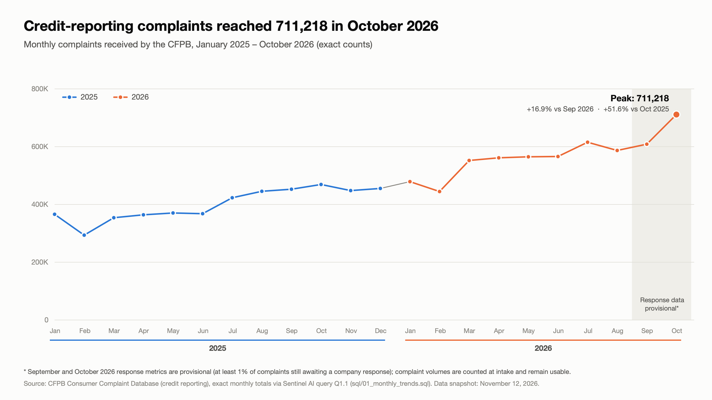
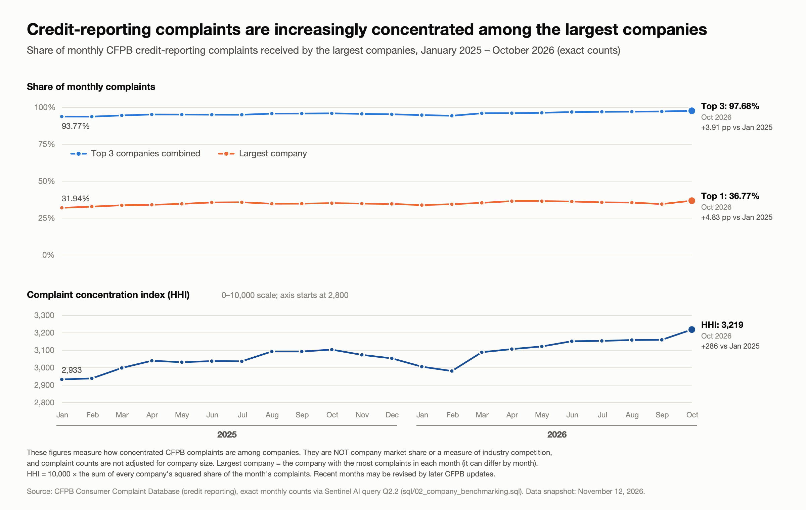
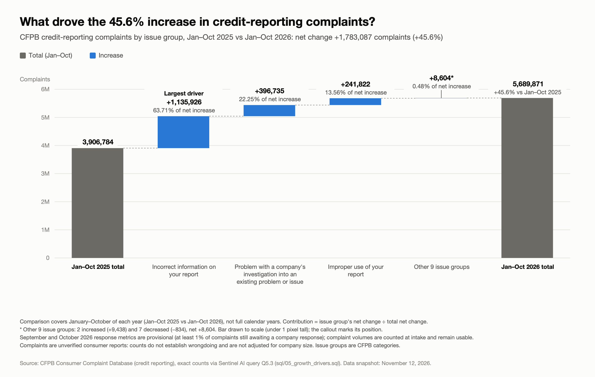

# Credit-Reporting Complaint Analytics — January 2025 to October 2026

An analysis of consumer complaints about credit reporting submitted to the U.S. Consumer Financial
Protection Bureau (CFPB), built on the Sentinel AI Databricks lakehouse. Every figure below comes
from the SQL showcase queries (`sql/02`–`06`), executed in Databricks and validated against
independent benchmarks: **17 of 17 queries passed, 63 of 63 checks**
([`sql/results/validation_summary.md`](../sql/results/validation_summary.md)). Query IDs in square
brackets (e.g. [Q5.1]) point to the exact query in [`sql/`](../sql/).

## Executive summary

- **Complaint volume grew 45.6% year to date.** January–October 2026 brought 5,689,871
  credit-reporting complaints, up 1,783,087 from 3,906,784 in the same months of 2025 [Q5.1].
  October 2026 alone had 711,218 complaints, 51.6% more than October 2025 [Q6.1].
- **Three companies receive almost all complaints.** TransUnion, Equifax and Experian together
  accounted for 95.86% of complaints over the 22 months [Q2.1], and complaints became more
  concentrated: the three largest companies' share rose from 93.77% in January 2025 to 97.68% in
  October 2026 [Q2.2]. Experian moved from third to first place between October 2025 and October 2026 [Q2.3].
- **Inaccurate information is the dominant and growing concern.** "Incorrect information on your
  report" is 59.21% of all complaints [Q3.1], its share rose 1.79 percentage points year to date
  [Q3.3], and it accounts for 63.71% of the overall increase [Q5.3]. The most common specific
  problem is information that consumers say belongs to someone else — an estimated 38.8% of all
  complaints (95% CI 38.37%–39.24%) [Q3.4].
- **Growth is broad but led by large states.** Texas is the largest source of complaints (15.67%)
  and grew fastest among the top three, by 70.4% year to date, contributing 21.93% of the national
  increase [Q4.2, Q4.3, Q5.4].
- **Companies answer on time, but outcomes have shifted.** In August 2026 — the latest month with
  complete response data — 99.92% of complaints received a timely response and 36.15% were closed
  with non-monetary relief [Q6.1], compared with 48.23% closed with non-monetary relief in January
  2025 [Q6.2].

## Key findings

### 1. Volume: rapid year-over-year growth

| Measure | Value | Source |
|---|---|---|
| Complaints, Jan–Oct 2025 | 3,906,784 | [Q5.1] |
| Complaints, Jan–Oct 2026 | 5,689,871 | [Q5.1] |
| Net change | +1,783,087 | [Q5.1] |
| Growth | +45.6% | [Q5.1] |
| October 2026 complaints | 711,218 | [Q6.1] |
| October 2026 vs September 2026 | +16.9% | [Q6.1] |
| October 2026 vs October 2025 | +51.6% | [Q6.1] |
| Three-month average to October 2026 | 635,540 | [Q6.1] |

The comparison uses matched months (January–October of each year) because 2026 data ends in
October. All volume figures are exact counts of complaints received.

*Monthly volume from the full Q1.1 result; September and October 2026 are shaded because their
response data is provisional (their volumes are unaffected).*

### 2. Companies: complaints are highly concentrated

| Company | Complaints, Jan 2025–Oct 2026 | Share of all complaints | Source |
|---|---|---|---|
| TRANSUNION INTERMEDIATE HOLDINGS, INC. | 3,567,685 | 33.98% | [Q2.1] |
| EQUIFAX, INC. | 3,368,770 | 32.08% | [Q2.1] |
| Experian Information Solutions Inc. | 3,128,932 | 29.80% | [Q2.1] |
| **Top three combined** | | **95.86%** | [Q2.1] |

Complaint concentration increased. The top three companies' share of monthly complaints was 93.77%
in January 2025 and 97.68% in October 2026; the complaint concentration index (HHI) rose from
2,933 to 3,219 [Q2.2]. This index measures how concentrated **complaints** are among companies; it
is not a measure of market share.

*Both panels are drawn from the full Q2.2 result, each on its own axis.*

The ranking among the three changed. Comparing October 2025 with October 2026 [Q2.3]:

| Company | Rank Oct 2025 → Oct 2026 | Share Oct 2025 → Oct 2026 | Change | Source |
|---|---|---|---|---|
| Experian Information Solutions Inc. | 3 → 1 | 27.37% → 36.77% | +9.4 pp | [Q2.3] |
| TRANSUNION INTERMEDIATE HOLDINGS, INC. | 2 → 2 | 33.45% → 32.85% | −0.6 pp | [Q2.3] |
| EQUIFAX, INC. | 1 → 3 | 35.14% → 28.06% | −7.08 pp | [Q2.3] |

### 3. Issues: inaccurate information dominates and is gaining share

| Issue | Share of all complaints, Jan 2025–Oct 2026 | Source |
|---|---|---|
| Incorrect information on your report | 59.21% | [Q3.1] |
| Improper use of your report | 21.54% | [Q3.1] |
| Problem with a company's investigation into an existing problem | 18.43% | [Q3.1] |

Year-to-date shift in issue mix, January–October 2025 vs 2026 [Q3.3]:

| Issue group | 2025 share | 2026 share | Change | Source |
|---|---|---|---|---|
| Incorrect information on your report | 57.99% | 59.78% | +1.79 pp | [Q3.3] |
| Improper use of your report | 23.57% | 20.44% | −3.14 pp | [Q3.3] |
| Problem with a company's investigation into an existing problem or issue | 17.62% | 19.07% | +1.45 pp | [Q3.3] |

The last group combines two near-identical CFPB issue labels ("…existing problem" and
"…existing issue"); this grouping is documented in `gold_issue_category_map`, and the original
labels are kept everywhere else.

Most common specific sub-issues, **estimated** from the weighted sample [Q3.4]:

| Issue › sub-issue | Estimated share of all complaints | 95% CI | Source |
|---|---|---|---|
| Incorrect information › Information belongs to someone else | 38.8% | 38.37%–39.24% | [Q3.4] |
| Improper use › Reporting company used your report improperly | 17.35% | 17.01%–17.69% | [Q3.4] |
| Incorrect information › Account information incorrect | 11.45% | 11.17%–11.74% | [Q3.4] |

### 4. Geography: large states lead volume and growth

Nearly all complaints come from the 50 states: 99.136%, with territories at 0.489% and the District
of Columbia at 0.284% [Q4.1]. The largest states by complaints, January 2025–October 2026 [Q4.2]:

| State | Complaints | Share of all complaints | Source |
|---|---|---|---|
| Texas | 1,645,206 | 15.67% | [Q4.2] |
| Florida | 1,553,437 | 14.79% | [Q4.2] |
| California | 946,282 | 9.01% | [Q4.2] |

The same three states had the largest year-to-date increases [Q4.3]: Texas +391,028 (+70.4%),
Florida +231,975 (+39.0%) and California +149,829 (+42.1%). These are complaint counts, not rates
per resident, so large states rank high partly because of their population.

### 5. Growth drivers: who and what account for the increase

Two different measures answer two different questions. **Percentage growth** is how fast a segment
grew; **contribution** is how much of the total increase of 1,783,087 complaints it accounts for
[Q5.1]. A small segment can grow quickly yet contribute little.

| Segment | Net change | Growth | Contribution to total increase | Source |
|---|---|---|---|---|
| TRANSUNION INTERMEDIATE HOLDINGS, INC. | +725,121 | +57.0% | 40.67% | [Q5.2] |
| Experian Information Solutions Inc. | +656,385 | +59.1% | 36.81% | [Q5.2] |
| EQUIFAX, INC. | +392,517 | +29.5% | 22.01% | [Q5.2] |
| Incorrect information on your report | +1,135,926 | +50.1% | 63.71% | [Q5.3] |
| Problem with a company's investigation into an existing problem or issue | +396,735 | +57.6% | 22.25% | [Q5.3] |
| Improper use of your report | +241,822 | +26.3% | 13.56% | [Q5.3] |
| Texas | +391,028 | +70.4% | 21.93% | [Q5.4] |
| Florida | +231,975 | +39.0% | 13.01% | [Q5.4] |
| California | +149,829 | +42.1% | 8.4% | [Q5.4] |

The three largest companies together account for 99.49% of the increase (derived:
40.67% + 36.81% + 22.01%) [Q5.2]. Equifax contributed the least of the three despite having the
second-largest complaint volume, because it grew more slowly (+29.5%) [Q5.2, Q2.1].

*The waterfall uses issue groups (Q5.3) rather than companies: Q5.3 covers every issue group, so its
net changes add up exactly to the total increase, whereas Q5.2 lists only the companies with the
largest changes. The nine smallest groups are combined into one bar. Bar lengths are net changes;
percentages are contributions to the total increase, not growth rates.*

### 6. Company responses: complete months only

Response outcomes are reported only for months in which fewer than 1% of complaints were still
"In progress". September and October 2026 do not meet this rule, so their response metrics are
excluded [Q6.1].

| Measure | January 2025 | August 2026 | Source |
|---|---|---|---|
| Timely response | 99.89% | 99.92% | [Q6.2], [Q6.1] |
| Closed with explanation | 51.71% | 63.75% | [Q6.2], [Q6.1] |
| Closed with non-monetary relief | 48.23% | 36.15% | [Q6.2], [Q6.1] |
| Closed with monetary relief | 0.027% | 0.01% | [Q6.2], [Q6.1] |

Between these two months the share closed with non-monetary relief is 12.08 percentage points
lower (derived: 48.23% − 36.15%) [Q6.2, Q6.1]. The months in between are in Q6.2 but are not part of
the exported preview, so this report does not describe the path between the two points.

## What this means for financial services

These findings describe what consumers report. Complaints are unverified submissions; they do not
establish that a company made an error or broke a rule, and volumes are not adjusted for the size of
each company's customer base.

- **Operations.** A 45.6% year-to-date increase [Q5.1] is a capacity signal for complaint handling
  and dispute investigation teams. With "Incorrect information on your report" accounting for
  63.71% of the increase [Q5.3], dispute-resolution workflows are where volume pressure concentrates.
- **Risk monitoring.** Complaint concentration in three companies (95.86% of complaints [Q2.1]) means
  that changes at any one of them move the national picture, as Experian's rise from third to first
  shows [Q2.3]. Monitoring should track concentration [Q2.2] and contribution to growth [Q5.2]
  alongside raw counts.
- **Customer experience.** The most common reported problem is information that consumers say
  belongs to someone else (estimated 38.8% of complaints [Q3.4]), which points to identity-matching
  and data-accuracy experiences as the area most visible to consumers. Responses are almost always
  timely (99.92% in August 2026 [Q6.1]); the outcome mix, not speed, is where change is visible
  between January 2025 and August 2026 [Q6.2, Q6.1].

## Exact counts vs estimates

| Type | Where it is used | How to read it |
|---|---|---|
| **Exact** population counts (CFPB API totals) | Volumes, growth, company / issue / state / response breakdowns [Q2.1–Q2.3, Q3.1–Q3.3, Q4.1–Q4.3, Q5.1–Q5.4, Q6.1–Q6.2] | Complete counts at the data snapshot; no sampling error |
| **Estimated** shares (weighted stratified sample) | Sub-issues [Q3.4]; company outcome profiles [Q2.4] | Point estimate with a 95% confidence interval; only rows flagged reliable are shown |

Estimates are used only where the CFPB data offers no exact breakdown. Their precision depends on
how many sample records support them: the leading sub-issue estimate has a confidence interval under
one percentage point wide (38.37%–39.24%) [Q3.4], whereas Capital One's estimated share of complaints
closed with explanation in 2025 is 80.88% with a 95% CI of 69.36%–88.77%, based on 60 sample records
[Q2.4]. Company outcome estimates use 2025 only, because periods that include September–October 2026
would mix in provisional response data [Q2.4].

## Methodology

- **Data.** CFPB Consumer Complaint Database, product "Credit reporting or other personal consumer
  reports", complaints received January 2025 – October 2026, processed through Bronze, Silver and
  Gold Delta tables in Databricks ([`docs/gold_methodology.md`](gold_methodology.md)).
- **Exact metrics** use complete monthly counts from the CFPB API. Multi-month shares divide summed
  counts by summed totals, never by averaging monthly percentages.
- **Estimates** come from a stratified sample with equal allocation per month, weighted to the exact
  monthly totals, with Wilson 95% confidence intervals
  ([`docs/data_sampling.md`](data_sampling.md)).
- **Year-to-date comparisons** use matched months; periods are derived from the data.
- **Provisional response data.** A month is provisional while at least 1% of its complaints are
  still "In progress". This is a reporting rule, not proof that other months are complete.
- **Growth measures.** Percentage growth is suppressed when the earlier period has fewer than 100
  complaints; contributions to the total change are reported separately.
- **Validation.** Queries Q2.1–Q6.2 were executed in Databricks by a read-only validation notebook
  and checked against benchmarks computed from the same reference data (17/17 PASS); Q1.1–Q1.3 were
  validated manually.

## Limitations

- Figures reflect the data snapshot used to build the lakehouse; later CFPB updates can revise them,
  especially for the most recent months.
- Company names are the CFPB's labels; related corporate entities are not merged.
- Complaint counts are not adjusted for company size, customer base or state population.
- Complaints are consumer submissions and are not verified by the CFPB.
- Response metrics for September and October 2026 are excluded as provisional.
- The validation report's previews contain the first three rows of each query (single-row queries
  are complete). Tables in this report quote only those rows and the benchmark-checked values. The
  charts use full exports of Q1.1, Q2.2 and Q5.2/Q5.3 instead (see [Charts](#charts)).

## Charts

| Chart | Section | Data |
|---|---|---|
| [Monthly complaint trends](assets/monthly_complaint_trends.png) | Volume | Full Q1.1 result, [`monthly_trends.csv`](../sql/results/exports/monthly_trends.csv) |
| [Company complaint concentration](assets/company_concentration.png) | Companies | Full Q2.2 result, [`company_concentration.json`](../sql/results/exports/company_concentration.json) |
| [Growth drivers waterfall](assets/growth_drivers_waterfall.png) | Growth drivers | Full Q5.3 result, [`growth_drivers.json`](../sql/results/exports/growth_drivers.json) |

Each chart is generated by a Python module in [`src/lakehouse/`](../src/lakehouse/) that validates the
export before drawing it (query status, row count, columns and internal arithmetic); the tests check
every plotted value against the export and the local reference data. SVG and PNG versions are in
[`assets/`](assets/).

## Sources

- Queries: [`sql/`](../sql/) (Q2.1–Q6.2 in files `02`–`06`)
- Verified results: [`sql/results/validation_report.json`](../sql/results/validation_report.json),
  [`sql/results/validation_summary.md`](../sql/results/validation_summary.md),
  [`sql/results/previews/`](../sql/results/previews/)
- Methodology: [`docs/gold_methodology.md`](gold_methodology.md),
  [`docs/data_sampling.md`](data_sampling.md)
